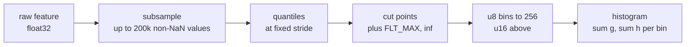

# 2. Binning & histograms

## The idea

To split a node (a group of training rows), you ask, for every feature, "which threshold best separates rows the model over-predicts from rows it under-predicts?" Each row's gradient (for squared error, its residual: prediction minus target) measures how wrong the model is on that row ([chapter 1](1-gradient-boosting.md)). The exact answer requires sorting every feature's values (expensive, repeatedly). The histogram trick answers a coarser question: it restricts the candidate thresholds to the boundaries of at most ~255 quantile buckets per feature, built **once**, up front. A node's split search is then just "sum gradients into 255 cells, scan the cells". No sorting ever again, and each feature value becomes a one-byte integer (two bytes above 256 bins), so more rows fit in the CPU cache.

Binning to at most 255 quantile bins limits candidate thresholds to about every 0.4th percentile of a feature (100/255). The search loses only the cut points between adjacent bin edges. XGBoost (`tree_method=hist`), LightGBM, and CatBoost all default to this, and the example below compares 32 and 255 bins.

## The pipeline

Each feature passes through the same five stages on every fit, from raw floats to the per-node histogram the split search scans:



Cuts are fit once, up front; the histogram is rebuilt per node.

## The math

Binning maps value to bucket via quantile cut points $c_0 < c_1 < \cdots < c_{k-1}$: bin $b$ holds values in $(c_{b-1}, c_b]$ (right-inclusive). Per node and feature, the histogram accumulates per-bin sums:

```math
\text{cell}[b] = \Big(\sum_i g_i,\; \sum_i h_i\Big)
\quad\text{over rows } i \text{ in the node with } \mathrm{bin}(x_i) = b
```

A candidate split "$\le b$" needs the left-side sums $G_L, H_L$ (a prefix sum over cells), and the right side is $G - G_L$ by subtraction from the node totals. One O(bins) scan scores every threshold of a feature ([chapter 3](3-finding-splits.md)).

**The subtraction trick**: when a node splits, its two children partition its rows, so $\text{hist}(\text{parent}) = \text{hist}(\text{left}) + \text{hist}(\text{right})$ cell-by-cell. Build the histogram only for the *smaller* child and get the larger one free: $\text{hist}(\text{large}) = \text{hist}(\text{parent}) - \text{hist}(\text{small})$. Since the smaller child has at most half the rows, building only that child removes at least half of each level's row scans.

## In bonsai

- **Fitting cuts**: [`BinMapper::fit`](../../src/bin_mapper.cpp): sample up to `n_samples` (200k by default) non-NaN values from the feature (a short feature is copied whole), sort the sample, then keep every distinct value when they fit the cut budget, place weighted cuts around heavy values, or otherwise take quantiles at a fixed stride. Append a `FLT_MAX` top-band cut (only if it is above the last cut) and a `+inf` sentinel. The **last bin is reserved for missing values** (NaN); in a CSV that is the literal `nan`, and a placeholder like -999 means missing only if you convert it to NaN first.
- **Binning**: [`Dataset::bin`](../../src/dataset.cpp): per feature, `transform` is a `lower_bound` over the cuts. Storage is column-major (`Dataset::visit_bins(fid, f)` hands `f` one contiguous column) because histogram building walks one feature across many rows.
- **The histogram**: [`include/bonsai/histogram.hpp`](../../include/bonsai/histogram.hpp): a move-only view (`std::span<HistCell>`) over `HistCell{sum_grad, sum_hess}` cells carved from the level's histogram arena or leased from the block pool. `add(bin, g, h)` is the entire hot loop body. `add` keeps no running totals. `totals()` sums the cells once per node, which replaced two double-adds per row and feature (decision 33).
- **Building per node**: `CpuHistogramEngine::populate_many` in [`src/grower.cpp`](../../src/grower.cpp), which routes each node to one of two fills. The choice is not simply u8 against u16. u16 bins always take the **feature-parallel fill** (`fill_columns`): one thread owns one feature's histogram and walks that column. u8 bins (`max_bin ≤ 256`, which covers the 255 default) are routed per node by density. A node holding at least a quarter of the rows takes that same feature-parallel fill (`k_col_fill_den = 4`); only the sparse remainder takes the **row-wise fill** (`fill_sparse`, decisions 49 and 105). The row-wise fill streams row chunks over a row-major mirror of the bins (`Dataset::mirror()`, laid out by `RowMirror`), reading each row's bins as one contiguous stretch of bytes into at most one partial histogram per thread range, reduced in fixed order. That mirror is column-block-tiled at 2048 features (`Dataset::mirror_tile_width`), so one block's histograms stay cache-resident on wide data. Why route at all: the column walk reads `bins[rows[k]]` at random row offsets. A node holding most rows uses every byte of each cache line it loads. A deep node with sparse rows uses about one byte per line, so every access misses. Decision 49 measured the effect on an M2 with 8 threads: about 0.7G adds/s on sparse nodes against about 3.3G adds/s on large dense nodes. The row-wise fill removes that gap (decisions 49 and 105), at the determinism price described in [chapter 9](9-parallelism-and-determinism.md).
- **The subtraction trick**: `plan_level` ([`src/grower_impl.hpp`](../../src/grower_impl.hpp)) and `build_children` ([`src/step/level.hpp`](../../src/step/level.hpp)) route every split so only the *smaller* child is populated and the larger derives by cell-wise subtract (`subtract_level`, [`src/step/primitives.hpp`](../../src/step/primitives.hpp)) with the parent's histograms *moved*, not copied; the CUDA engine runs the same plan with a subtract kernel on device histograms.

## Missing values

Every feature reserves its last bin for NaN. That bin never enters the threshold scan. Each split instead learns a `default_left` bit, the side missing rows follow, chosen by whichever direction scores higher gain. One tree can route NaN left at one node and right at another.

Finite values above the last real cut used to bin as missing. Training routed them by `default_left`, but prediction sent them right of every threshold, so the same row could route two ways. The [missing-bin case](../learn/engine/2-the-missing-bin.md) closed that skew (decisions 73 and 74).

## The Dataset API

Bin edges can also come from you, not from quantiles. Pass `bin_edges` to `bonsai.Dataset` and the listed features bin at your cut points, which are saved inside the model. Age bins such as under 18, 18 to 65 and over 65 then stay the same at training and prediction time, with no separate preprocessing step to keep in sync:

```python {.run}
import numpy as np
import bonsai

rng = np.random.default_rng(0)
n = 2000
age = rng.uniform(0.0, 100.0, n).astype(np.float32)
noise = rng.random((n, 2), dtype=np.float32)
X = np.column_stack([age, noise]).astype(np.float32)
band = np.digitize(age, [18.0, 65.0]).astype(np.float32)
y = (band * 2.0 + rng.normal(0, 0.05, n)).astype(np.float32)

# Column 0 bins at the two domain edges; the rest fit as usual.
ds = bonsai.Dataset(X, y, bin_edges={0: np.array([18.0, 65.0], dtype=np.float32)})
model = bonsai.train({"booster.n_iters": 30, "tree.max_depth": 4}, ds)

# The edges live in the model, so predict reads raw ages.
probe = np.array([[10.0, 0.5, 0.5], [40.0, 0.5, 0.5], [80.0, 0.5, 0.5]], dtype=np.float32)
print(np.asarray(model.predict(probe)).round(2))
```

The bins are right-inclusive, so `18.0` bins with the group below it. Edges must be finite and strictly increasing, and each column's list must be non-empty and fit the bin budget. An out-of-range column or any violation of these raises `RuntimeError` ([decision 73](../decisions.md)).

## Try it

Coarser bins trade split resolution for speed. Set `max_bin` low and watch accuracy hold on smooth features:

```python {.run}
import numpy as np
import bonsai

rng = np.random.default_rng(0)
X = rng.normal(size=(4000, 8)).astype(np.float32)
y = (X[:, 0] * 2.0 + X[:, 1] + rng.normal(0, 0.1, 4000)).astype(np.float32)

for max_bin in (32, 255):
    m = bonsai.BonsaiRegressor(n_iters=60, max_bin=max_bin).fit(X, y)
    rmse = float(np.sqrt(np.mean((np.asarray(m.predict(X)) - y) ** 2)))
    print(f"max_bin={max_bin:3d}  train RMSE={rmse:.4f}")
```

The run above shows accuracy holding on smooth features while each histogram scan covers about 8x fewer cells (32 bins instead of 255). Coarser bins can lose accuracy when a feature's useful thresholds fall between two quantile edges, so compare validation error at your own `max_bin` before lowering it. The default is 255 ([parameters](../api/parameters.md)).

## Gotchas & war stories

- **The missing bin participates in every histogram** but is excluded from the threshold sweep; split scoring decides which side NaNs travel ([chapter 3](3-finding-splits.md)). Forgetting that the last bin is special is the classic off-by-one of this design.
- **Accumulate in double, store in float.** Cells are float pairs, because gradients arrive as float and a cell's sum is bounded by its node's size. Every reduction across cells (totals, prefix scans, the finder's running left sums) accumulates in double and converts once at the store, so only per-cell storage carries float rounding (decision 50). A float has a 24-bit significand (about 7 decimal digits) and a double has 53 bits (about 16). Each add to a float running sum rounds the addend to the sum's precision, so over half a million adds the error can grow far larger than any single gradient. A double keeps those low digits.
- **Row order = reproducibility.** FP addition isn't associative, so *the order rows enter `add` is part of the contract*. bonsai keeps each node's rows in ascending order (a stable split scatter), which is also why its histograms are bit-identical at a fixed thread count ([chapter 9](9-parallelism-and-determinism.md) gives the full contract: u16 bins and dense nodes hold at any thread count, but the u8 row-wise fill does not).
