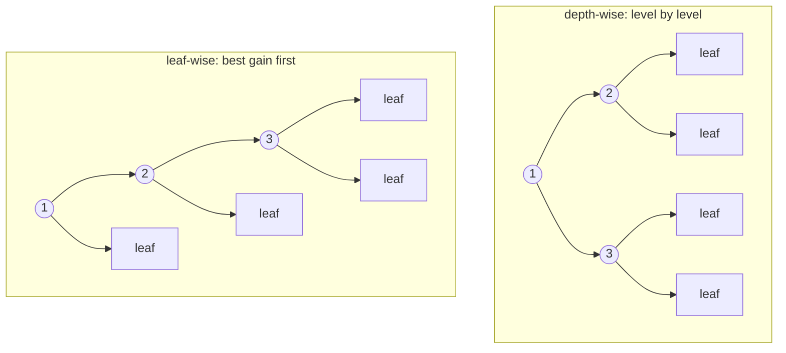
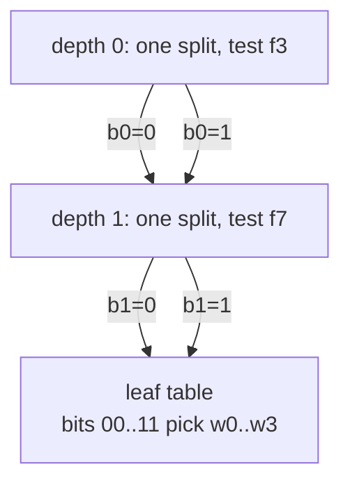

# 4. Growing trees

## The idea

Chapters 2–3 explain how to split *one* node. A grower decides **which node to split next**, and that scheduling choice is most of what distinguishes the three reference libraries:

- **Depth-wise** (XGBoost's default): split every node at depth `d` before touching depth `d+1`. Balanced trees, capped by `max_depth`.
- **Leaf-wise / best-first** (LightGBM's default): always split the single leaf (anywhere in the tree) whose best split has the highest gain. Deliberately *unbalanced*: it spends each split where the gain is largest, so a fixed leaf budget (`max_leaves`) goes to the highest-gain splits, and it can grow deep, narrow branches that fit small datasets closely; bound that with `min_data_in_leaf`.
- **Level-wise / symmetric** (CatBoost): every node at a level shares *one* split. The tree is a table of 2^depth leaves indexed by a bitstring, so predict is a branchless gather that reads one leaf per row. Sharing one split per level limits the tree to depth-many distinct splits, which regularizes it. CatBoost calls the shape an *oblivious* tree; bonsai names the grower after the growth order, `levelwise`, and keeps *oblivious* for the tree it emits.

The diagrams below number the nodes in growth order, on the same split budget.



An oblivious tree spends one split per level, shared by every node on it. The leaves become a flat table indexed by the path bits (each level's split test gives one bit), so predict reads one leaf from the table with no branches:



A shared split can send every row of a node to one child, which leaves the other child empty. Its whole subtree stays empty down to the last level. An empty node gets no histograms: the level fill allocates no histogram arena (the block of per-feature bin counts) for it, and the level finder skips it. On the wide CPU cell, a fifth of the deepest level's smaller children held no rows, and skipping them cut the levelwise train time by 21% on one pod ([decision 159](../decisions.md)).

## The math

There's no new math, only a different order of choosing nodes over the same gain scores. Depth-wise takes nodes in the order they were created (first in, first out, a plain queue). Leaf-wise always takes the node with the highest gain, kept in a max-heap (a structure that returns its largest item first). Level-wise picks one shared split for the whole level by summing every node's gain for each candidate (feature, bin).

```
depth-wise:  queue, oldest node first     (one vector of nodes per depth, one loop per depth)
leaf-wise:   max-heap, highest gain first (pop best, split, push two children)
level-wise:  argmax over the SUM of per-parent gains for one shared (feature, bin)
```

Each leaf-wise expansion turns one leaf into two (net +1 leaf), so `max_leaves` bounds the tree exactly. The tree is the greedy sequence of the first `max_leaves - 1` highest-gain splits. A depth-wise tree spends its splits level by level, and a leaf-wise tree spends them on the highest-gain leaves.

## In bonsai

All three share every mechanism from chapters 2–3 (`make_root`, `split_node`, `finalize_as_leaf`, the same split finders) and differ only in their grow loop ([`src/grower_impl.hpp`](../../src/grower_impl.hpp)):

- `DepthwiseGrower::grow`: `current` / `next` frontier vectors (the open nodes of this level and of the next), `plan_level` splits or finalizes each node of a level (the `LevelStep` methods fill and find on the level), `commit_children` gathers the children and swaps `current` and `next`, repeat until `max_depth`.
- `LeafwiseGrower::grow_leaves` (called by `LeafwiseGrower::grow` unless the budget cannot bind and the node arena is under 2 MiB, see the gotcha below) keeps a `std::vector<Candidate>` ordered with `std::push_heap` and `std::pop_heap`. It avoids `std::priority_queue` because `top()` returns a const reference, which stops the grower from moving the candidate's histograms out of the queue. Ties in gain break on the lower node id, so growth is deterministic. Stops at `max_leaves`, `max_depth`, or a drained heap. The design record, including why the heap is a `std::vector` and what `max_leaves = 0` means, is [decision 31](../decisions.md).
- `ObliviousGrower::grow`: one shared split per level via the *level* finder (gain = sum of per-parent gains, see decision 30 for the fold-then-score mistake that summing per-parent fixes), children by index arithmetic, leaves in a $2^{\text{depth}}$ table.

Both node-splitting growers emit a `DenseTree` (flat node array); the levelwise grower emits an `ObliviousTree` (level splits + leaf table), [`include/bonsai/tree.hpp`](../../include/bonsai/tree.hpp). Selection is a config string: `dispatch.grower_name = depthwise | leafwise | levelwise`.

## A second, orthogonal axis: the boosting scheme

Growth structure (*where splits go*) is only one of two axes. The other is the **boosting scheme** (*how each row's gradient is computed*):

- **Plain** (every library's default at scale, and bonsai's only mode): row $i$'s gradient comes from the full current ensemble's prediction for row $i$, an ensemble that was trained on all rows, including $i$ itself.
- **Ordered** (CatBoost's small-data mode): row $i$'s gradient comes from a model trained only on the rows *before* $i$ in a random permutation, so the gradient never sees $i$'s own label. This removes a subtle bias CatBoost calls **prediction shift**, the same self-referential leak that [ordered target statistics](13-categorical-features.md) fix for categorical encodings, one level up.

The two axes are independent: any structure composes with any scheme. CatBoost *bundles* oblivious trees with ordered boosting, but that is a packaging choice, not a dependency: you can grow depth-wise trees with ordered gradients, or oblivious trees with plain ones.

Seen this way, bonsai spans the **structure** axis as widely as CatBoost, with three growth disciplines (CatBoost's SymmetricTree, Depthwise and Lossguide), and more widely than XGBoost's two (depth/leaf). What it does not offer is the ordered *scheme*, and that was a measured decision. Toggling CatBoost's own `boosting_type` at 200k rows gave test r² 0.8722 for ordered and 0.8720 for plain, at about 7x the fit time. CatBoost itself defaults to plain boosting past ~50k rows. The same toggle also measured at zero or below on a 12-dataset small numeric pool (decision 81). The one place a gap remains is categorical-heavy data, where the target-statistics *encoder* applies the ordered idea in preprocessing without a core change. CatBoost's native per-split machinery is 68% of its remaining lead there (decision 80), and averaging permutations in the encoder does not close it (decision 82). The cost ladder is in [decisions 63 and 81](../decisions.md), and the measurements are in [benchmarks/catboost-scale-edge-2026-07.md](../../benchmarks/catboost-scale-edge-2026-07.md).

## Try it

```python {.run}
import numpy as np
import bonsai

rng = np.random.default_rng(0)
X = rng.normal(size=(4000, 10)).astype(np.float32)
y = (X[:, 0] + X[:, 1] * X[:, 2] + rng.normal(0, 0.1, 4000)).astype(np.float32)

for grower in ("depthwise", "leafwise", "levelwise"):
    m = bonsai.BonsaiRegressor(n_iters=60, grower=grower).fit(X, y)
    rmse = float(np.sqrt(np.mean((np.asarray(m.predict(X)) - y) ** 2)))
    print(f"{grower:10s}  train RMSE={rmse:.4f}")
```

On this toy problem, depthwise and leafwise land close together (about 0.63 train RMSE), and levelwise lands lower (about 0.49). Train RMSE is not a held-out measure, and the ordering depends on the data. The [scenario panels](../results/results/perf.md) compare the growers on fit time and held-out accuracy.

## Gotchas & war stories

- **`max_leaves` vs `max_depth` govern different growers.** A leafwise config that only sets `max_depth=8` still stops at the default 31 leaves: the budget, not the cap, is usually what binds.
- **A `max_leaves` that cannot bind gives the depthwise tree.** A depth-$D$ tree has at most $2^D$ leaves, so `max_leaves = 0` or `max_leaves >= 2^max_depth` never stops an expansion. The leafwise tree is then the depthwise tree, grown one leaf at a time. On the device the registry routes such a config to `cuda_depthwise`. The tree is the same to float rounding, and it grows in one round per level instead of one round per leaf (decision 132). On the host the leafwise grower picks per fit, by the size of one node's histogram arena (one 8-byte cell per bin of every feature). Under 2 MiB (1024 features at 255 bins), it hands the tree to the level plane, the depthwise grower that fills every node of a level together. That takes at most `max_depth` rounds (8 at depth 8) where one round per leaf takes 255, and the whole level stays in cache. Above 2 MiB, the leaf plane grows the tree itself. It fills and reads one histogram while it is cache-resident, where a level round streams every node's (decision 147). The config and the saved model keep `leafwise` as written. `BONSAI_GROW_PROFILE=1` prints which plane took the tree.
- **Heap ties are a determinism hazard.** Equal gains happen (symmetric data produces them exactly); without the node-id tie-break, two runs could grow different trees and both look "correct".
- **The levelwise gain is a sum of per-parent gains, not the gain of summed histograms.** The score is quadratic in $G$, so folding histograms first computes the wrong thing. The original implementation did, and produced degenerate trees whose failure mode looked plausible enough to get rationalized (decision 30). The re-implementation matches CatBoost's per-leaf aggregation.
